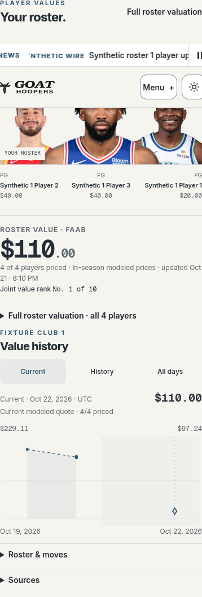
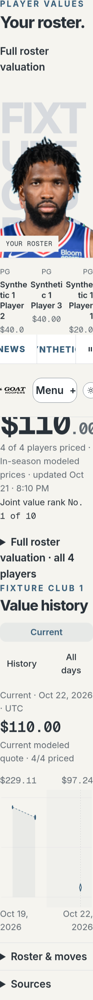
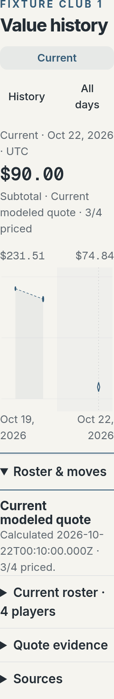

# Shared current quote review

Base: `c923dfc268551ee16c35609ec720d2afec8fe18b`. All data in this browser evidence is synthetic.

The headline, Current chart marker and readout use one validated projection of the existing homepage summary. Historical points, saved current-roster quotes, generation and comparisons are preserved separately. No extra market load, fetch or persistence occurs.

Local checks: 60 focused tests across seven files, TypeScript, scoped ESLint, Python compile and diff checks passed. The actual Next synthetic production fixture built, then all twelve browser journeys passed. Two additional captures verify the default inspector is collapsed and headline/readout match. The full application build and broader regression suite remain required exact-head CI checks.

Browser cases include 1440px/390px/320px, 100%/200% root text, partial/unpriced/empty/unknown membership, long names, same-day coincident current/saved values, retrospective provenance and UTC rollover. Two journeys exercise delayed old detail responses, same-team RSC refresh, stale generation 409 refresh and retained historical date/focus. No external request, browser write or page error was observed. The final focus-outline separation is 12px at 100% text and 24px at 200%.

Receipts: [checks](current-checks.json), [full browser assertions/source blobs](current-browser.json), [initial views](initial-views.json). Reproduce with `prepare-current.py`, `serve.py` and `current-browser.py` as documented in the parent README.

This is source/fixture verification, not a claim about the screenshot's live account or complete historical recovery. Prior ordinary production navigation failed at the browser transport before content; no bypass or repeated attempt was made. Historical acquisition and producer work remains separate.
